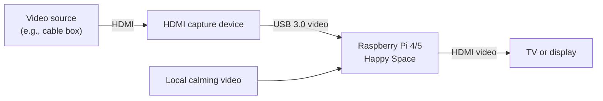
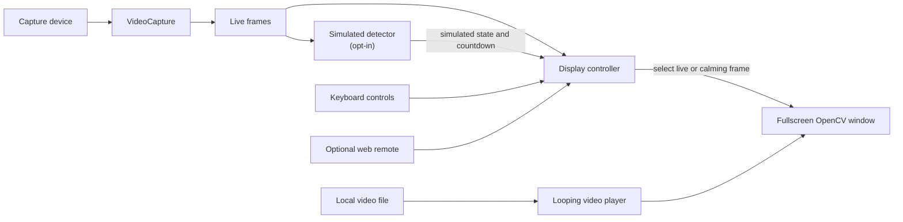
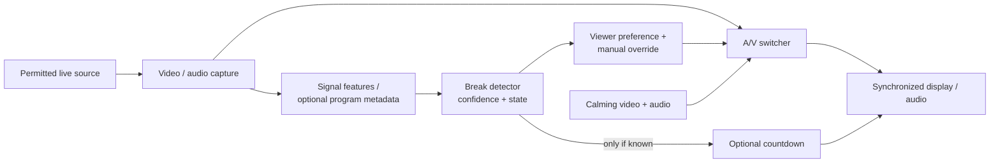

# <span style="color:#E0B659">Happy Space</span>


Happy Space is an early prototype for giving viewers a choice during commercial
breaks: keep watching the original video or temporarily replace it with a
calming loop such as a fish tank, fireplace, or ocean. The long-term goal is to
detect breaks automatically and, when reliable information is available, show
the remaining time.

## <span style="color:#E0B659">What works today</span>

- Displays video from an OpenCV capture device in a fullscreen window.
- Lets the viewer manually switch between the live picture and a looping local
  video; the live picture is selected at startup.
- Offers an **opt-in simulated detector** for testing: 10 seconds of live video,
  followed by a 5-second simulated break, repeating. Its countdown is based on
  that simulation, not on the input signal.
- Optionally provides a password-protected web remote for a phone or other
  device on the local network.

**There is no real commercial detection yet.** The application processes
video only: it does not capture, switch, mute, or play audio. It does not provide
an HDMI passthrough when it exits. Playback speed of the calming video currently
depends on the capture loop, rather than the file's frame rate. Real-time
performance, latency, and supported capture formats depend on the hardware.

## <span style="color:#E0B659">Hardware overview</span>

A Raspberry Pi's HDMI ports are outputs, not inputs. One possible setup is:



You need a compatible USB HDMI capture device, a display, and suitable cables.
The capture device and Pi must support the source resolution and frame rate;
1080p/30 is requested, but the device may negotiate something different. The
prototype needs a graphical desktop session for its OpenCV window.

**Content protection:** many HDMI sources use HDCP. Ordinary capture devices
may reject protected content or display a black screen. This project does not
bypass HDCP; use sources and capture hardware that permit capture, and observe
applicable rights and terms.

### <span style="color:#E0B659">Raspberry Pi requirements</span>

These are **planning estimates**, not tested minimums or performance
guarantees. Happy Space has not yet been benchmarked on these Pi models.
Actual memory, storage, frame rate, and latency depend on the OS, capture
device, video format, and other running software.

| Component | Practical minimum | Recommended |
| --- | --- | --- |
| Raspberry Pi | Raspberry Pi 4 Model B | Raspberry Pi 5 |
| RAM | 2 GB | 4 GB or more |
| Storage capacity | 16 GB microSD card or compatible USB drive | 32 GB or larger microSD card or SSD |
| Free disk space | Allow at least 2 GB free after installing the OS | 4 GB or more free after installing the OS |
| Operating system | 64-bit Raspberry Pi OS with a graphical desktop | Current 64-bit Raspberry Pi OS with a graphical desktop |
| Video input | Linux-compatible USB HDMI capture device and permitted source | USB 3.0 capture device capable of the desired resolution and frame rate |
| Output | HDMI-connected display or TV | Display or TV matching the intended output resolution |
| Network | Not required for keyboard controls | Local Wi-Fi or Ethernet for the optional phone remote |

Storage capacity includes the operating system; the free-space allowances are
additional working room for Happy Space, dependencies, and updates. More space
is needed for additional videos and varies with the OS image and installation
method. The included fish tank video is about 13 MB. This app requests
1080p/30 capture, but the device may negotiate another format; even the
recommended setup has not been validated to sustain it. A suitable power
supply and cooling are advisable for continuous video processing.

The phone remote avoids a keyboard for normal controls, but it does not
replace the graphical desktop and display used to show video. Automatic
desktop login and startup are described below.

### <span style="color:#E0B659">HDMI capture device requirements</span>

These are **selection guidelines**, not a list of tested devices. No specific
capture device or performance level has been validated for Happy Space.

| Component | Practical minimum | Recommended |
| --- | --- | --- |
| HDMI input | Accepts the resolution and frame rate output by your permitted source | Supports the source's intended resolution and frame rate without extra conversion |
| USB capture output | A video format usable by Linux and OpenCV; lower resolutions may work if 1080p/30 is unavailable | Supports **1920 × 1080 at 30 fps over USB** for the selected video format |
| Linux compatibility | Works with Raspberry Pi OS as a video capture device, typically via USB Video Class (UVC) | UVC device with documented Linux/Raspberry Pi compatibility and accessible `/dev/video*` device |
| USB connection | Compatible with the Pi and the capture format's bandwidth needs | USB 3.0 capture device connected to a USB 3.0 port |
| Power | Operates reliably from the Pi's available USB power | Adequately powered for continuous operation; use a suitable powered hub if the manufacturer requires one |
| Video format and latency | A format OpenCV can decode and acceptable delay for your use | Confirm supported formats and low-latency operation with the actual Pi and source |

Check the specifications for **USB capture output**, not just the HDMI input
or passthrough. For example, “4K input” does not necessarily mean 4K capture,
and advertised 1080p/30 may apply only to particular USB formats. Happy Space
requests 1080p/30 but does not check whether the device accepted that setting
or explicitly choose a format. The negotiated format, sustained frame rate,
and display delay must be tested with your hardware.

The device must accept the source's HDMI signal, including its resolution and
frame rate. It cannot capture HDCP-protected content unless the complete
capture path is authorized to do so; Happy Space does not bypass protection.
HDMI passthrough is optional and is separate from the Pi's displayed output.
The application currently handles video only, so capture-device audio support
does not provide audio in Happy Space.

#### <span style="color:#E0B659">Devices to consider</span>

These are candidates based on manufacturers' published specifications, **not
devices tested or guaranteed to work with Happy Space or a Raspberry Pi**.
Check the source's HDMI output format, available USB power, and the seller's
return policy before buying.

| Device | Why consider it | Important considerations |
| --- | --- | --- |
| [Magewell USB Capture HDMI Gen 2](https://www.magewell.com/tech-specs/usb-capture-hdmi-gen-2) | Manufacturer lists Linux ARM and 1080p/30 and 1080p/60 capture over USB 3.0. | Intended for HD input, not a 4K HDMI source. A strong first candidate for a 1080p source, but Pi performance remains untested. |
| [Magewell USB Capture HDMI 4K Plus](https://www.magewell.com/tech-specs/usb-capture-hdmi-4k-plus) | Manufacturer lists Linux ARM, 1080p/30 capture, and support for 4K HDMI input and loop-through. | Higher-spec option; manufacturer specifies up to approximately 7 W, so check the Pi's available USB power or use an appropriately powered hub. |
| [AVerMedia Live Streamer CAP 4K (BU113)](https://www.avermedia.com/product-detail/BU113) | Manufacturer lists UVC, USB 3.0 and up to 1080p/60 recording, as well as 4K HDMI input. | USB 2.0 is not supported. The manufacturer lists Windows and macOS requirements rather than Raspberry Pi OS; UVC alone does not guarantee Pi or OpenCV compatibility. |

**Shopping references (US):** Prices and availability change and may differ
by seller, condition, tax, and shipping. Amazon prices could not be verified;
the prices below are other retailers' reference prices, not Amazon quotes.
Checked November 7, 2026.

| Device | Amazon | Reference price |
| --- | --- | --- |
| Magewell USB Capture HDMI Gen 2 (32060) | [Search Amazon](https://www.amazon.com/s?k=Magewell+USB+Capture+HDMI+Gen+2+32060) | Approximately $319 USD, [B&H listing](https://www.bhphotovideo.com/c/product/1105735-REG/magewell_xi_100_d_usb_hdmi_one_hd_hdmi_usb.html), reported in search results; direct price could not be verified. |
| Magewell USB Capture HDMI 4K Plus (32090) | [Search Amazon](https://www.amazon.com/s?k=Magewell+USB+Capture+HDMI+4K+Plus+32090) | Approximately $545 USD, [B&H listing](https://www.bhphotovideo.com/c/product/1358688-REG/magewell_32090_usb_3_0_dongle_1_channel.html), reported in search results; direct price could not be verified. |
| AVerMedia BU113 | [Search Amazon](https://www.amazon.com/s?k=AVerMedia+BU113+Live+Streamer+CAP+4K) | $69.99 USD sale price at [AVerMedia's US store](https://shop-us.avermedia.com/products/avermedia-live-streamer-bu113), listed as sold out when checked; regular price $99.99. |

For any candidate, test with the actual Pi, capture device, cables, and
permitted source. Confirm the device is accessible, produces the desired
format, and runs continuously at an acceptable frame rate and latency. Happy
Space requests 1080p/30 regardless of a device's higher advertised maximum.

## <span style="color:#E0B659">Current software architecture</span>



The capture loop continues reading live frames while the calming video is shown.
The demo detector uses elapsed time, not visual or audio cues. Manual switching
does not guess a remaining time. The selection applies only to the displayed
video; audio is not part of this pipeline.

## <span style="color:#E0B659">Getting started</span>

1. Connect the capture device and a permitted video source, then connect a
   display to the computer. On Raspberry Pi, use a graphical Raspberry Pi OS
   session.
2. Install Python and OpenCV with GUI support. For example, on Raspberry Pi OS:

   ```bash
   sudo apt update
   sudo apt install python3-opencv python3-numpy
   ```

   Alternatively, create a Python virtual environment and install the
   dependencies there:

   ```bash
   python3 -m venv .venv
   .venv/bin/python -m pip install -r requirements.txt
   ```

   If creating the environment fails, install `python3-venv` with apt first.
   OpenCV wheels and video codecs must be supported by your system; do not use
   the headless OpenCV package for the fullscreen window.
3. The repository includes `assets/fishtank.mp4`. Edit `config.json` if your
   capture device or video file differs.
4. From the project directory, run:

   ```bash
   python3 main.py                  # apt-installed dependencies
   # OR
   .venv/bin/python main.py         # virtual environment
   ```

   To use a different configuration file, run `python3 main.py --config
   /path/to/config.json`. Relative video paths are resolved relative to that
   configuration file.

### <span style="color:#E0B659">Controls</span>

The OpenCV window must have keyboard focus.

| Key | Action |
| --- | --- |
| `m` | Toggle between the live picture and the calming video. If demo mode is active, take manual control and switch away from the currently displayed choice. |
| `d` | Turn simulated detection on or off. Enabling starts a fresh live period; disabling returns to live video. |
| `q` or `Esc` | Quit and release the capture and video devices. |

### <span style="color:#E0B659">Configuration</span>

| Key | Meaning |
| --- | --- |
| `capture_device_id` | OpenCV capture device index, typically `0`; select the index corresponding to your capture hardware. |
| `calming_video_path` | Path to a local video, relative to the config file or absolute. |
| `timer_font_scale` | OpenCV font scale for the simulated countdown. |
| `timer_color` | Countdown text color as an OpenCV BGR triplet, for example `[255, 255, 255]` for white. |

The program reports capture and video open/read errors and exits rather than
pretending a failed video is playing. Check device permissions, codec support,
the configured path, and whether the source is HDCP-protected if startup or
capture fails.

## <span style="color:#E0B659">Phone remote</span>

The remote is disabled by default. It runs in the Happy Space process, so it
becomes available only after the video and window have opened successfully;
it stops when the app exits. The Pi still needs a graphical desktop session
and a TV or display for the video, but a phone can replace the keyboard for
switching modes.

1. Connect the Pi and phone to the same **trusted** local network. HTTP does
   not encrypt the password or commands. Anyone able to observe network
   traffic could obtain the password. Do not expose the port to the internet,
   configure router port forwarding, or use this on an untrusted network.
   The password does not prevent guessing attempts; choose a strong, unique
   password and restrict network access with your firewall if appropriate.
2. Create a password file outside the repository. The password must contain
   12-256 printable ASCII characters. For example, run the following **once**
   on the Pi to generate one; the redirection overwrites an existing file:

   ```bash
   mkdir -p ~/.config/happyspace
   umask 077
   python3 -c 'import secrets; print(secrets.token_urlsafe(24))' > ~/.config/happyspace/password
   cat ~/.config/happyspace/password
   ```

   Keep the file private and never commit or share it. The `cat` command shows
   the password to enter on the phone.
3. From the project directory, start the app in the Pi's graphical desktop:

   ```bash
   .venv/bin/python main.py --web --web-password-file ~/.config/happyspace/password
   ```

   If you installed the dependencies with apt instead, use `python3` in place
   of `.venv/bin/python`. Add `--config /path/to/config.pi.json` if you use a
   separate configuration.
4. Run `hostname -I` on the Pi and find its local network address. On the
   phone, open `http://PI_ADDRESS:8080/`, substituting that address, and enter
   the password. Use the buttons to choose live video or the calming video, or
   turn the **simulated** demo on or off. Manual selection turns demo mode off.
   The page reports the current selection, demo mode, and connection status;
   it does not stream video to the phone.

Select **Setup** on the remote to choose an MP4 file from the project's
`assets` folder, or choose **Random video**, then select **Save settings**.
The list includes files directly in that folder, including `.MP4`; it does not
include subfolders or links to files outside the folder. Reopen Setup to
refresh the list after adding or removing files. A fixed selection loops that
file. Random mode picks a video each time one finishes; the same video can be
chosen more than once. A saved change applies on the next capture frame, even
when the calming video is already showing.

The selection is saved in `.happyspace-settings/<config filename>` alongside
the chosen configuration file, and is reused on restart, including when the
web remote is disabled. The settings directory is ignored by Git and is not
shared automatically between computers. Until a choice is saved, the existing
`calming_video_path` setting remains in effect, including paths outside
`assets`. To return to that default, stop the app and remove the settings
file for the relevant configuration. If a saved video is removed, restore it
or remove that settings file before restarting. An empty assets folder cannot
be used for random mode; unreadable videos produce an error rather than a
placeholder.

The default listener binds to all IPv4 interfaces on port 8080, not just
Wi-Fi. Use `--web-bind PI_LOCAL_IP` to restrict the listening interface and
`--web-port PORT` to change the port; update the phone's URL accordingly.
Ensure the selected interface exists and the firewall permits access from
your phone. A bind error or missing/invalid password file stops startup
instead of enabling an unprotected remote.

### <span style="color:#E0B659">Test the remote on the same computer</span>

You can test the app on a laptop with a compatible webcam in place of the HDMI
capture device. A graphical desktop and a working capture device are still
required. Configure `capture_device_id` if the default device is not the
webcam you want to use.

1. If Happy Space is already running, focus its video window and press `q` or
   `Esc` to quit. Starting `main.py` without `--web` does not start the remote.
2. Create a password file as described above, then start the app from the
   project directory, specifying that file:

   ```bash
   .venv/bin/python main.py --web --web-bind 127.0.0.1 \
     --web-port 8081 --web-password-file ~/.config/happyspace/password
   ```

   Leave the app running and check the terminal for
   `Web remote listening on 127.0.0.1:8081`. The loopback address limits
   access to this computer; a phone cannot connect to it.
3. Open `http://127.0.0.1:8081/` in a browser on the same computer, enter the
   password from the file, and use **Setup** and the remote controls. Focus
   the video window and press `q` or `Esc` when finished.

If the browser reports **connection refused**, confirm the app is still
running with `--web`, the listening message appeared, and the URL uses the
same port as `--web-port`. An old browser tab may point to a server that has
stopped. Check the terminal for startup or capture errors; the remote shuts
down if the app exits. If the terminal reports **address already in use**,
choose another free port with `--web-port` and use that port in the URL.

### <span style="color:#E0B659">Start automatically on the Pi</span>

The desktop's autostart facility can launch Happy Space when the Pi user logs
in. Configure Raspberry Pi OS to log that user into the graphical desktop
automatically if unattended startup is desired; this makes that account
accessible to anyone with physical access. A display/TV and working capture
device must be connected. This is not a headless system service.

1. Test the phone remote manually first. Find the absolute project path with
   `pwd` in its directory, and your user home directory with `echo "$HOME"`.
2. Create `~/.config/autostart/happy-space.desktop` using a text editor, such
   as `nano`, creating the directory first:

   ```bash
   mkdir -p ~/.config/autostart
   nano ~/.config/autostart/happy-space.desktop
   ```

3. Paste the following, replacing **each** `/home/USER` and project path with
   the Pi's actual absolute paths. For an apt installation, replace the first
   executable with `/usr/bin/python3`. If using a custom configuration, add
   `--config` and its absolute path to the `Exec` line.

   ```ini
   [Desktop Entry]
   Type=Application
   Name=Happy Space
   Icon=/home/USER/HappySpace/assets/happy-space-icon.png
   Exec="/home/USER/HappySpace/.venv/bin/python" "/home/USER/HappySpace/main.py" --web --web-password-file "/home/USER/.config/happyspace/password"
   Terminal=false
   ```

4. Log out and back in, or reboot, and open the remote from the phone. To
   disable autostart, remove that desktop entry. The remote has no shutdown
   button; `q` or `Esc` exits when a keyboard is available. If startup fails,
   run the manual command above in a desktop terminal to see the error.
   The desktop entry's icon may appear in the desktop's launcher or task switcher,
   depending on the desktop environment; OpenCV controls the video window.

## <span style="color:#E0B659">Updating on Raspberry Pi</span>

These steps assume the Pi already has a Git clone of the repository. Changes
made on another computer must be committed and pushed to the branch used by
the Pi before they can be downloaded. For example, on that computer, use
`git push origin main` after committing changes on `main`.

1. Quit Happy Space with `q` or `Esc`, then open a terminal on the Pi and change to
   your clone's directory:

   ```bash
   cd /path/to/HappySpace
   git status
   ```

   Check for local changes before updating. In particular, `config.json` and
   the included video are tracked by Git. Back up any changes you want to keep.
   Git may refuse an update if local changes would be overwritten; commit or
   stash them first rather than discarding them. If you use `git stash`, restore
   the changes afterward with `git stash pop` and resolve any conflicts.
2. Update the current branch from its configured upstream:

   ```bash
   git pull --ff-only
   ```

   If there is no upstream branch, or the branch has diverged, inspect
   `git status` and resolve the branch situation before continuing. A pull
   cannot fetch changes that have not yet been pushed.
3. Refresh dependencies using the same installation method used for setup:

   ```bash
   # Virtual environment
   .venv/bin/python -m pip install -r requirements.txt

   # OR, for apt-installed dependencies
   sudo apt update
   sudo apt install python3-opencv python3-numpy
   ```

4. Start the app again in a graphical desktop session, using the corresponding
   command from Getting started.

To keep Pi-specific settings separate from the tracked `config.json`, create a
copy once with `cp config.json config.pi.json`, edit it, and start with
`python3 main.py --config config.pi.json` (or use `.venv/bin/python` for a
virtual environment). Keep the copy in the project directory so its relative
video path still points to `assets/fishtank.mp4`. Do not rerun the copy command
if it would overwrite settings you want to keep.

## <span style="color:#E0B659">Future architecture</span>

The following is a direction for future work, **not an implementation claim**:



Useful next steps include evaluating detection against labeled recordings,
handling uncertain predictions and transitions, integrating synchronized audio,
and timing calming playback independently of input frame rate. A countdown
should be omitted when the break duration is unknown; visual changes alone do
not reliably identify commercials or predict their duration. Real-world
validation should measure false positives, missed breaks, switching delay, and
end-to-end latency across representative sources.

## <span style="color:#E0B659">Tests</span>

With the runtime dependencies installed, run:

```bash
python3 -m unittest discover -s tests -v
# Or, with a virtual environment:
.venv/bin/python -m unittest discover -s tests -v
```

The tests use mocked devices; they do not validate actual capture hardware,
HDMI compatibility, or on-screen rendering.

## <span style="color:#E0B659">License</span>

Happy Space is licensed under the [MIT License](LICENSE). Copyright (c) 2026
Bryan Price. See the license file for the full terms.

## <span style="color:#E0B659">Attribution</span>

If you build upon Happy Space, attribution is appreciated:

> Based on HappySpace (github.com/bryanspms/HappySpace) by Bryan Price

Happy Space uses [OpenCV](https://opencv.org/) and
[NumPy](https://numpy.org/). These projects and their dependencies have their
own licenses; consult their distribution information for applicable terms.

The included `assets/fishtank.mp4` was sourced from
[Vibrant Aquarium with Colorful Fish Swimming on Pexels](https://www.pexels.com/video/vibrant-aquarium-with-colorful-fish-swimming-40535664/)
and compressed for this project. The `assets/fireplace.mp4` video was sourced
from [A fire is burning in a fireplace with a black background](https://www.pexels.com/video/a-fire-is-burning-in-a-fireplace-with-a-black-background-26583810/)
by IslandHopper X on Pexels and compressed for this project. Consult the
[Pexels License](https://www.pexels.com/license/) and verify that your intended
use and redistribution comply with its terms; the project's MIT License does
not grant rights to these videos.
