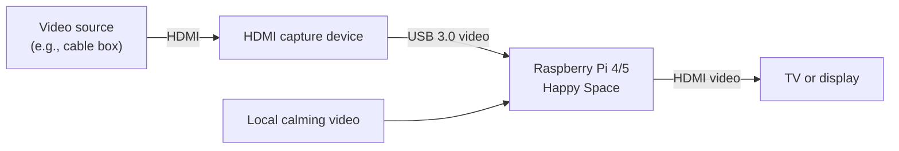
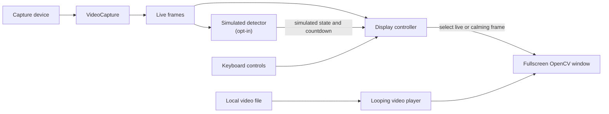
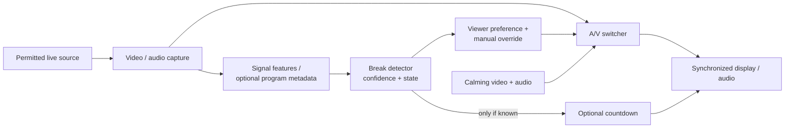

# Happy Space

Happy Space is an early prototype for giving viewers a choice during commercial
breaks: keep watching the original video or temporarily replace it with a
calming loop such as a fish tank, fireplace, or ocean. The long-term goal is to
detect breaks automatically and, when reliable information is available, show
the remaining time.

## What works today

- Displays video from an OpenCV capture device in a fullscreen window.
- Lets the viewer manually switch between the live picture and a looping local
  video; the live picture is selected at startup.
- Offers an **opt-in simulated detector** for testing: 10 seconds of live video,
  followed by a 5-second simulated break, repeating. Its countdown is based on
  that simulation, not on the input signal.

**There is no real commercial detection yet.** The application processes
video only: it does not capture, switch, mute, or play audio. It does not provide
an HDMI passthrough when it exits. Playback speed of the calming video currently
depends on the capture loop, rather than the file's frame rate. Real-time
performance, latency, and supported capture formats depend on the hardware.

## Hardware overview

A Raspberry Pi's HDMI ports are outputs, not inputs. One possible setup is:



You need a compatible USB HDMI capture device, a display, and suitable cables.
The capture device and Pi must support the source resolution and frame rate;
1080p/30 is requested, but the device may negotiate something different. The
prototype needs a graphical desktop session for its OpenCV window.

**Content protection:** many HDMI sources use HDCP. Ordinary capture devices
may reject protected content or display a black screen. This project does not
bypass HDCP; use sources and capture hardware that permit capture, and observe
applicable rights and terms.

## Current software architecture



The capture loop continues reading live frames while the calming video is shown.
The demo detector uses elapsed time, not visual or audio cues. Manual switching
does not guess a remaining time. The selection applies only to the displayed
video; audio is not part of this pipeline.

## Getting started

1. Connect the capture device and a permitted video source, then connect a
   display to the computer. On Raspberry Pi, use a graphical Raspberry Pi OS
   session.
2. Install Python and OpenCV with GUI support. For example, on Raspberry Pi OS:

   ```bash
   sudo apt update
   sudo apt install python3-opencv python3-numpy
   ```

   Alternatively, create a Python virtual environment and install the
   dependencies there:

   ```bash
   python3 -m venv .venv
   .venv/bin/python -m pip install -r requirements.txt
   ```

   If creating the environment fails, install `python3-venv` with apt first.
   OpenCV wheels and video codecs must be supported by your system; do not use
   the headless OpenCV package for the fullscreen window.
3. The repository includes `assets/fishtank.mp4`. Edit `config.json` if your
   capture device or video file differs.
4. From the project directory, run:

   ```bash
   python3 main.py                  # apt-installed dependencies
   # OR
   .venv/bin/python main.py         # virtual environment
   ```

   To use a different configuration file, run `python3 main.py --config
   /path/to/config.json`. Relative video paths are resolved relative to that
   configuration file.

### Controls

The OpenCV window must have keyboard focus.

| Key | Action |
| --- | --- |
| `m` | Toggle between the live picture and the calming video. If demo mode is active, take manual control and switch away from the currently displayed choice. |
| `d` | Turn simulated detection on or off. Enabling starts a fresh live period; disabling returns to live video. |
| `q` | Quit and release the capture and video devices. |

### Configuration

| Key | Meaning |
| --- | --- |
| `capture_device_id` | OpenCV capture device index, typically `0`; select the index corresponding to your capture hardware. |
| `calming_video_path` | Path to a local video, relative to the config file or absolute. |
| `timer_font_scale` | OpenCV font scale for the simulated countdown. |
| `timer_color` | Countdown text color as an OpenCV BGR triplet, for example `[255, 255, 255]` for white. |

The program reports capture and video open/read errors and exits rather than
pretending a failed video is playing. Check device permissions, codec support,
the configured path, and whether the source is HDCP-protected if startup or
capture fails.

## Updating on Raspberry Pi

These steps assume the Pi already has a Git clone of the repository. Changes
made on another computer must be committed and pushed to the branch used by
the Pi before they can be downloaded. For example, on that computer, use
`git push origin main` after committing changes on `main`.

1. Quit Happy Space with `q`, then open a terminal on the Pi and change to
   your clone's directory:

   ```bash
   cd /path/to/HappySpace
   git status
   ```

   Check for local changes before updating. In particular, `config.json` and
   the included video are tracked by Git. Back up any changes you want to keep.
   Git may refuse an update if local changes would be overwritten; commit or
   stash them first rather than discarding them. If you use `git stash`, restore
   the changes afterward with `git stash pop` and resolve any conflicts.
2. Update the current branch from its configured upstream:

   ```bash
   git pull --ff-only
   ```

   If there is no upstream branch, or the branch has diverged, inspect
   `git status` and resolve the branch situation before continuing. A pull
   cannot fetch changes that have not yet been pushed.
3. Refresh dependencies using the same installation method used for setup:

   ```bash
   # Virtual environment
   .venv/bin/python -m pip install -r requirements.txt

   # OR, for apt-installed dependencies
   sudo apt update
   sudo apt install python3-opencv python3-numpy
   ```

4. Start the app again in a graphical desktop session, using the corresponding
   command from Getting started.

To keep Pi-specific settings separate from the tracked `config.json`, create a
copy once with `cp config.json config.pi.json`, edit it, and start with
`python3 main.py --config config.pi.json` (or use `.venv/bin/python` for a
virtual environment). Keep the copy in the project directory so its relative
video path still points to `assets/fishtank.mp4`. Do not rerun the copy command
if it would overwrite settings you want to keep.

## Future architecture

The following is a direction for future work, **not an implementation claim**:



Useful next steps include evaluating detection against labeled recordings,
handling uncertain predictions and transitions, integrating synchronized audio,
and timing calming playback independently of input frame rate. A countdown
should be omitted when the break duration is unknown; visual changes alone do
not reliably identify commercials or predict their duration. Real-world
validation should measure false positives, missed breaks, switching delay, and
end-to-end latency across representative sources.

## Tests

With the runtime dependencies installed, run:

```bash
python3 -m unittest discover -s tests -v
```

The tests use mocked devices; they do not validate actual capture hardware,
HDMI compatibility, or on-screen rendering.
